# Bonchosu

**A money manager for Android that does the boring typing for you.**
*"Biar nggak boncos lagi."*

Bonchosu keeps track of where your money goes. Instead of typing every payment in by hand, it can read your
bank notifications, your e-statements and photos of your receipts, then asks you to confirm before anything counts.
Everything stays on your phone.

Available in **English** and **Bahasa Indonesia**.

  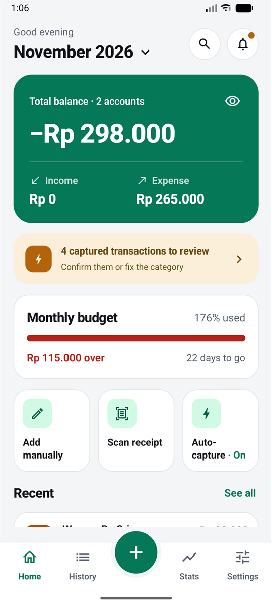
  &nbsp;
  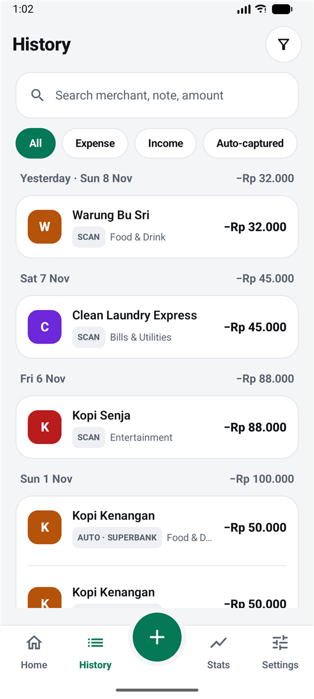
  &nbsp;
  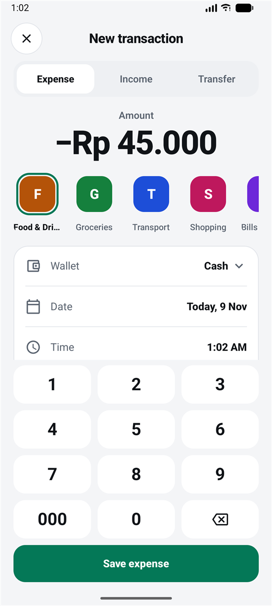

---

## What it can do

### See your money at a glance
- **Home** shows your total balance, this month's income and expense, your monthly budget and your latest
  transactions. Tap the month to look back at earlier months.
- **History** lists everything by day. Search by shop, note or amount, and filter by expense, income or
  auto-captured.
- **Stats** break spending down by category and show the last 6 months.
- **Wallets** for cash, bank accounts, e-wallets and credit cards, with live balances.
- **Hide balances** with one tap when you're in public.

### Make it yours
- **Light, dark or follow your phone**, plus a **pure black** mode that saves battery on OLED screens.
- **Four accent colours**: Emerald, Blue, Violet and Orange. On Android 12 and newer, **dynamic colour** can take
  the colours from your wallpaper instead.
- **A live preview** shows the change before you leave the screen, and the whole app recolours instantly.
- **Customise Home**: choose which cards show, in what order, and which figures the balance card shows.

  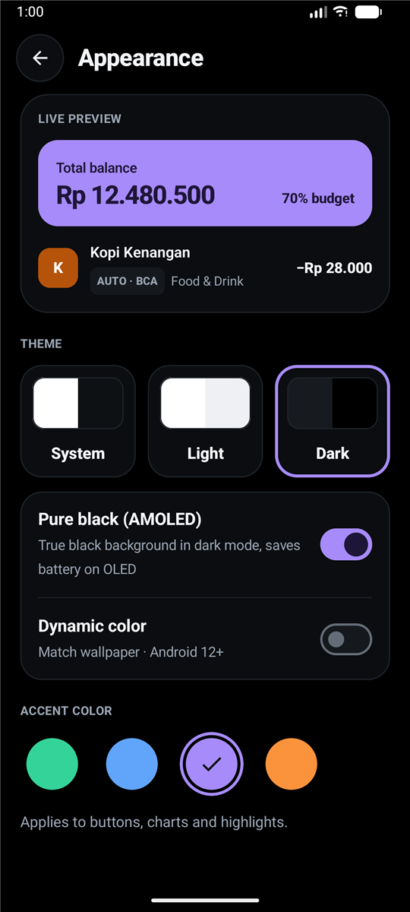
  &nbsp;
  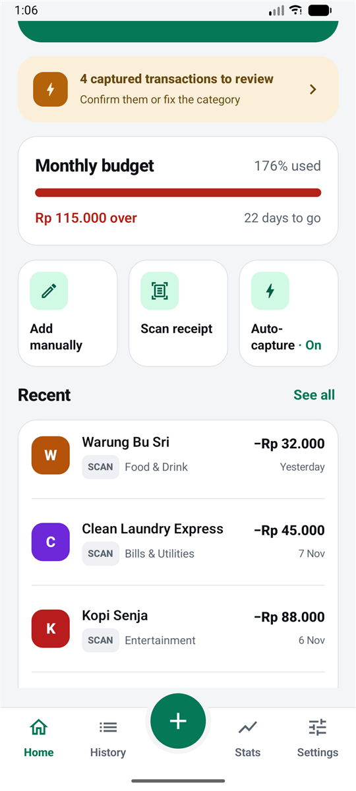

### Record spending without typing
- **Quick add.** The **+** button opens a number pad. Type the amount, tap a category and save.
- **Bank and e-wallet notifications.** Turn on auto-capture, pick your banking apps (BCA, Mandiri, BRI, BNI,
  SeaBank, Superbank, GoPay, OVO, DANA, ShopeePay or any other), and payments are noted down as they happen.
- **E-statements.** Pick the PDF or screenshots from your bank. The app reads every row, spots the ones you
  already have, and works with any Indonesian bank. Password-protected PDFs are fine.
- **Receipt photos.** Pick several photos at once. Each receipt becomes one expense with the shop, date and total.
  Photos that aren't receipts are skipped, and the same receipt twice is caught.

Nothing goes straight into your balance: new items wait in a **review inbox** (the bell on Home) until you confirm them.

  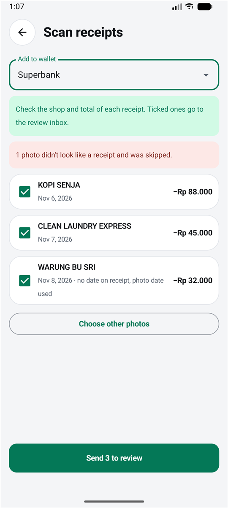
  &nbsp;
  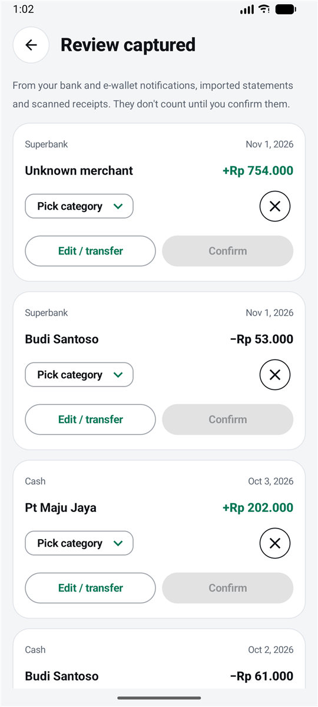

### Categories that sort themselves
- The app guesses the category: "Indomaret" is Groceries, "GoFood" is Food & Drink, "PLN" is Bills.
- **It learns.** Fix a category once and that shop goes to the right place next time.
- **Keyword rules.** Add your own words, like *"laundry" → Bills* or *"kos" → Family*.
  Any transaction mentioning that word gets that category.

  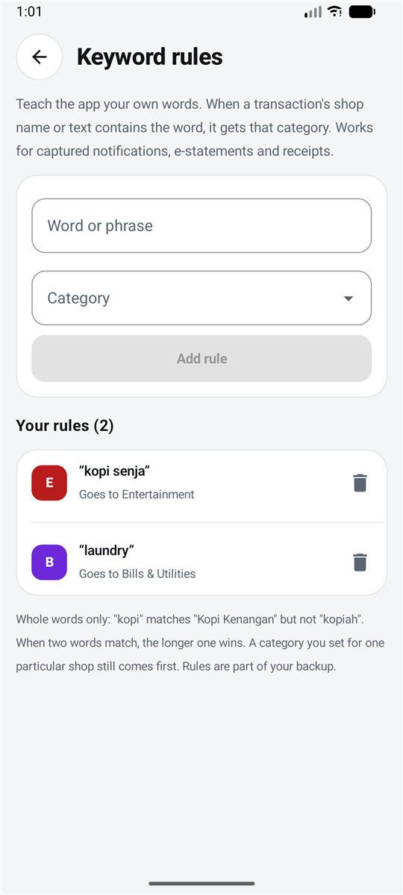
  &nbsp;
  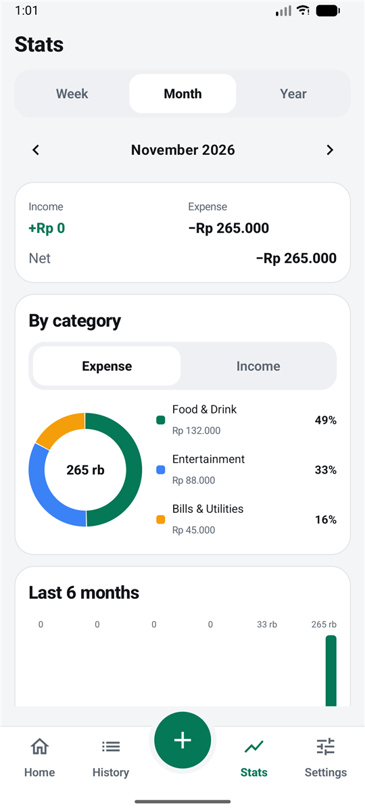

### Split a bill fairly
Snap the restaurant receipt, say how many people were there and tap who had what.
Tax, service charge and discounts are shared out by what each person ordered, so nobody pays for someone
else's steak. Only your own orders count as your spending, and the app keeps track of who still owes you.

  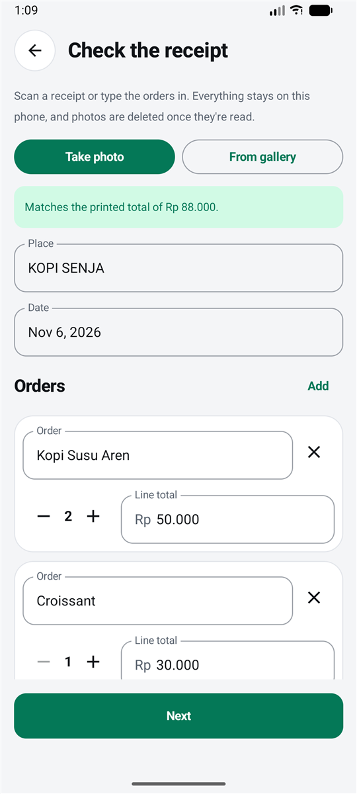
  &nbsp;
  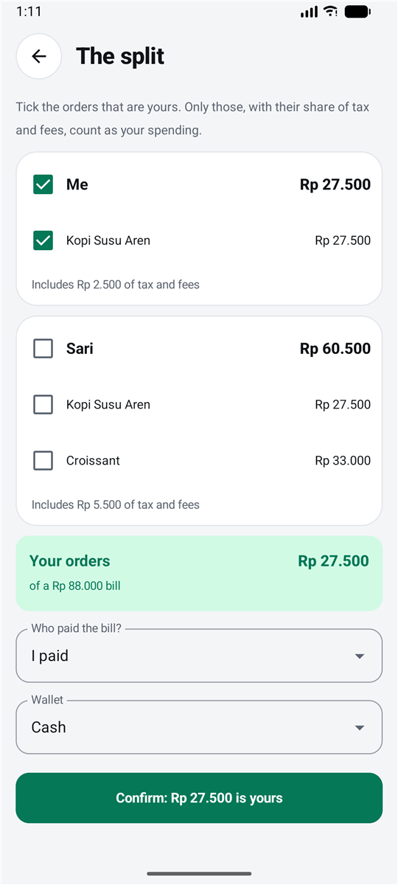

### Stay on budget
- Budgets per category or for everything, weekly or monthly. Home shows how much is used, how much is left and
  how many days to go.
- A **notification** when you reach 50%, 75% and 100%, or any levels you choose.
- **Recurring** payments like rent, subscriptions and salary are added automatically.

### Keep your data safe
**Backup & restore** saves everything (wallets, transactions, budgets, split bills, keyword rules and settings,
including your theme) into one file. Save it to Google Drive and load it back on a new phone.

  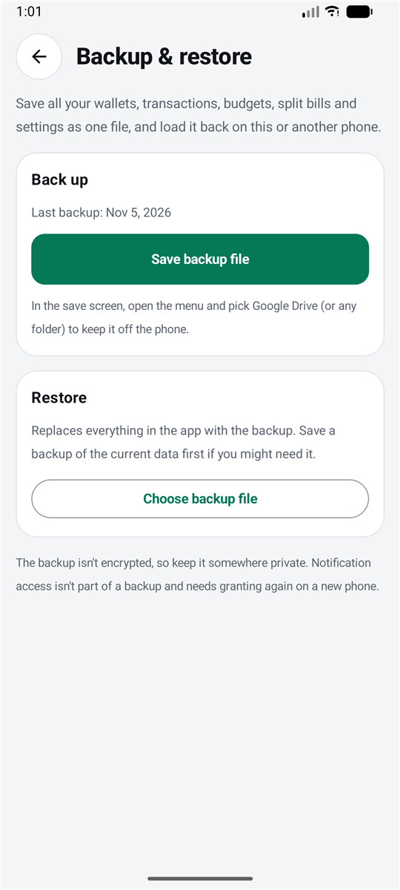

---

## Your privacy

- **Everything stays on your phone.** There's no account, no server and no ads. Receipts, statements and
  notifications are read on the device itself.
- **Auto-capture is off until you turn it on**, and it only reads notifications from the apps you pick.
- **Nothing counts until you say so.** Anything read automatically waits in the review inbox first.
- Photos and PDFs are only read, never kept, and PDF passwords aren't saved.
- Backups aren't encrypted, so keep the file somewhere private.

---

## Getting started

1. Install the app and open it. You start with a Cash wallet.
2. Add your other wallets: **Settings → Wallets → Add wallet** (or tap "Total balance" on Home).
3. Tap **+** to add a payment by hand, or use the quick actions on Home:
   - **Scan receipt** to turn receipt photos into expenses
   - **Auto-capture** to read bank notifications
   - **Settings → Import e-statement** for your monthly statement
4. When the bell on Home shows a dot, open the review inbox and tap **Confirm**.
5. Make it yours in **Settings → Appearance**.
6. Every so often: **Settings → Backup & restore → Save backup file**, then pick Google Drive.

## Questions

**My bank's notifications aren't picked up.**
Check that the app is ticked in **Settings → Labs → Apps to capture from**, and that notification access shows
"Granted". Some banks word things unusually. Payments the app doesn't recognise are simply skipped, never guessed.

**A category keeps coming out wrong.**
Fix it once in the review inbox and the app remembers that shop. For a whole group of shops, add a keyword rule.

**Where did Budgets go?**
The monthly budget sits on Home; tap it to see all budgets. They're also in **Settings → Budgets**.

**I got a new phone.**
On the old phone, save a backup to Google Drive. On the new one, install the app and choose
**Backup & restore → Choose backup file**. Turn on notification access again, because Android doesn't let apps
carry that permission over.

**Does it work on iPhone?**
Not yet. iPhones don't allow apps to read other apps' notifications, so auto-capture couldn't work there.

---

For developers: how to build, test and change the app is in [docs/DEVELOPERS.md](docs/DEVELOPERS.md).
